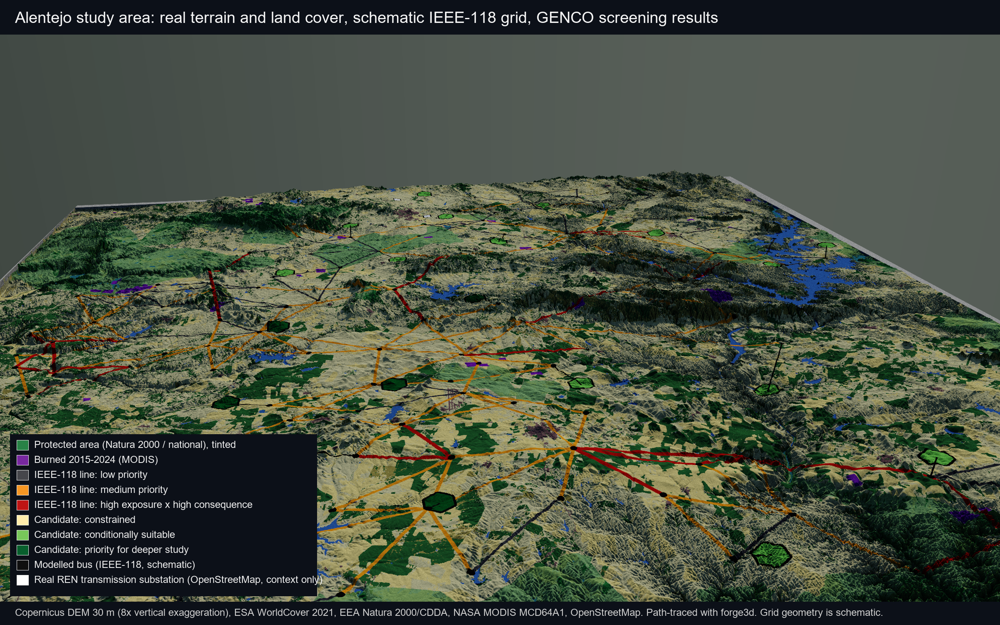
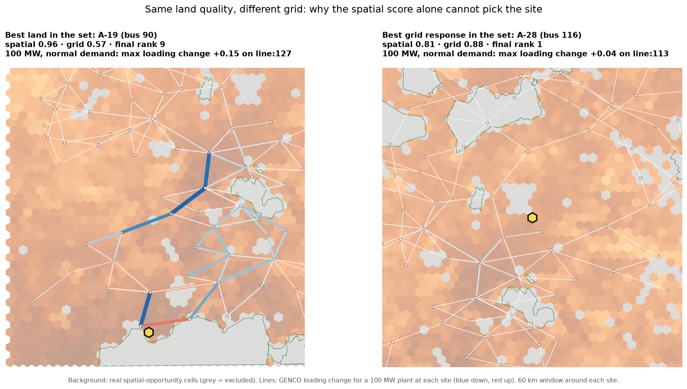
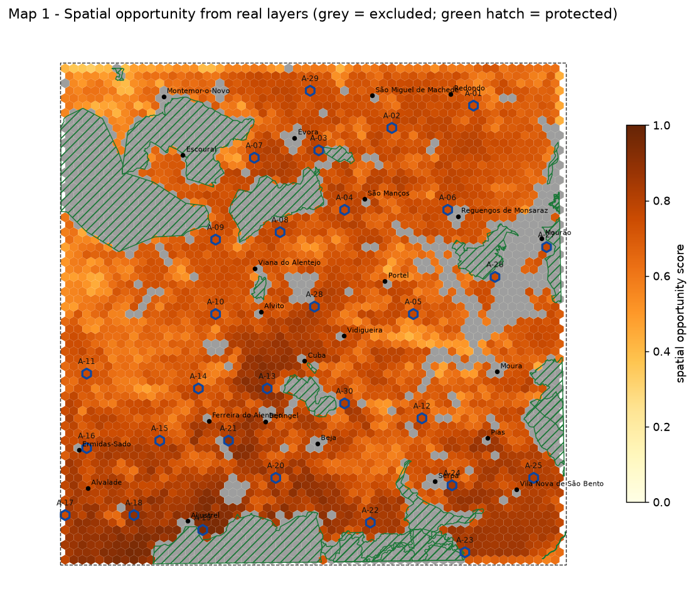
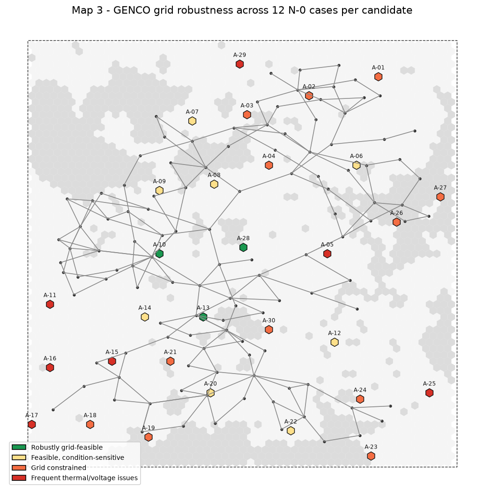
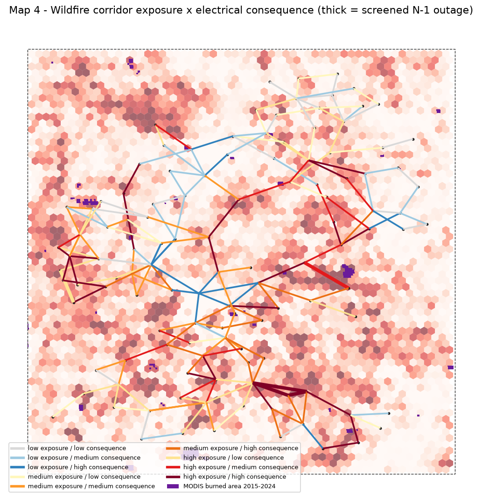
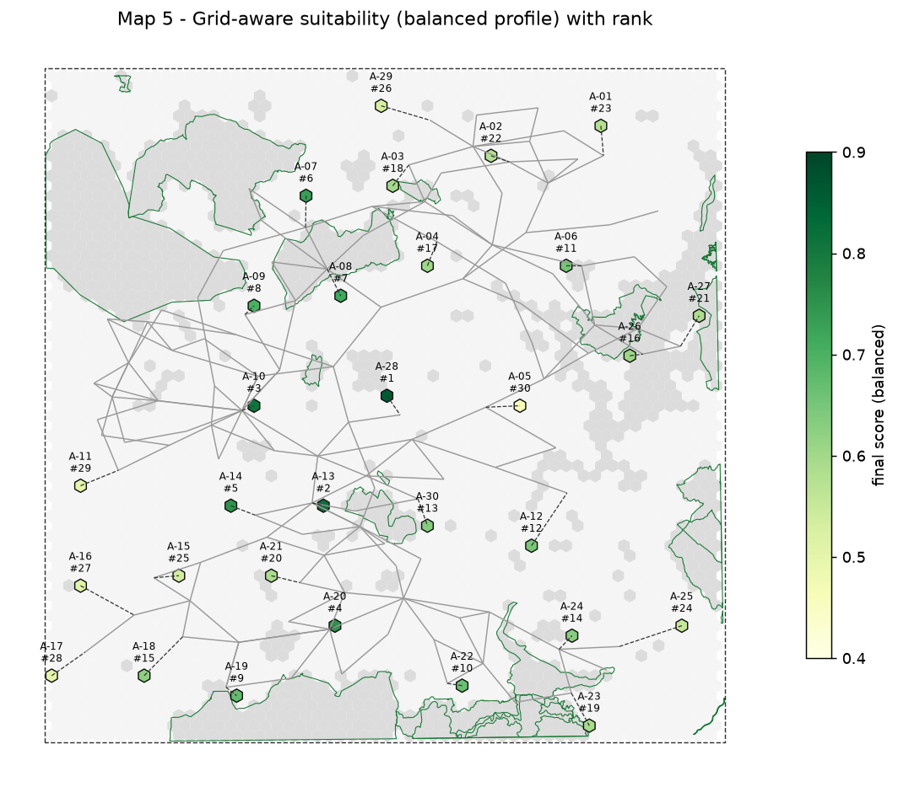
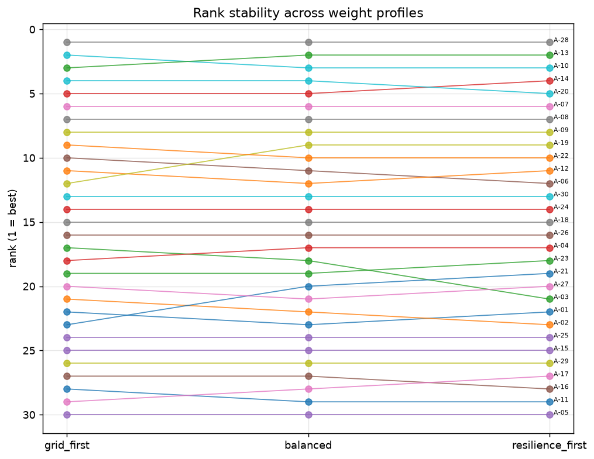
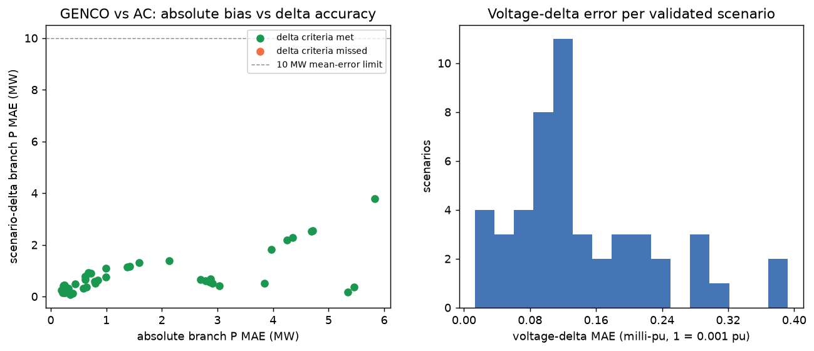
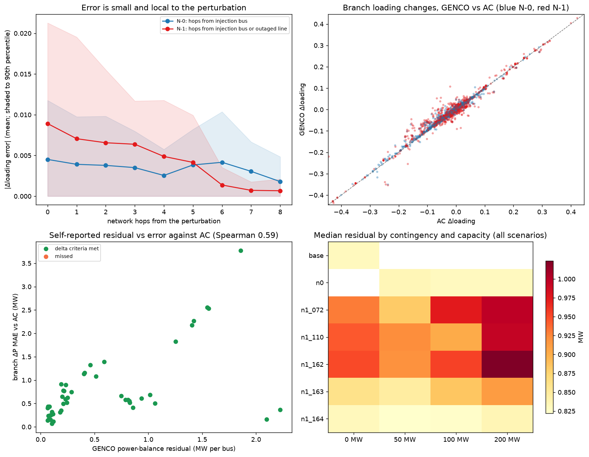
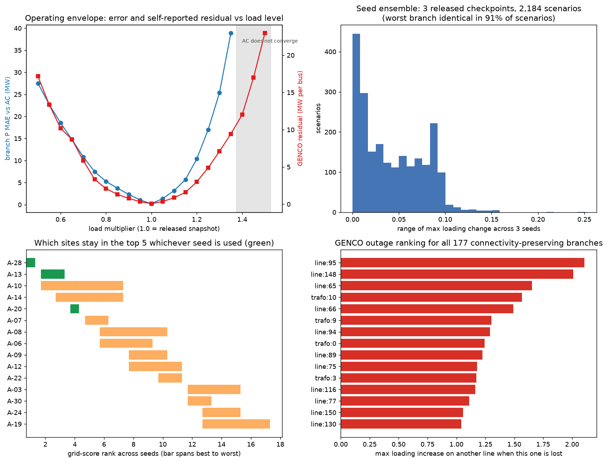

# GeoGridLens case study: grid-aware siting in Alentejo with GENCO and real geodata

*Generated 2026-10-22 22:36 UTC from the pipeline outputs. Re-run `scripts/write_case_study_report.py` after any change.*

## 1. The decision

**User.** An early-stage solar developer or transmission planner screening where a **100 MW solar plant (optionally with a 50 MW battery)** could connect in a ~100 km x 100 km area of Alentejo, Portugal (Evora - Beja - Alqueva).

**Question.** Where is a project (a) geographically plausible, (b) low-impact on the grid across capacities and operating conditions, (c) robust under line outages, and (d) not dependent on wildfire-exposed corridors?

**Why GENCO.** The screening matrix is 2,160 interventions (30 sites x 3 capacities x 4 conditions x 6 contingency states) plus 24 baselines. GENCO solved all of them at a median **44 ms per scenario** on CPU; pandapower Newton-Raphson, used for validation only, took a median **34 ms** per case. The point is not the per-case speed-up but that the full matrix becomes a routine, repeatable screen whose results are then checked against a conventional solver on a documented subset.

> **What is real and what is not.** Terrain, land cover, protected areas, burned areas, solar resource and settlements are real open data (Section 2). The electrical network is the IEEE-118 benchmark, laid out deterministically inside the study box. Bus/line positions, candidate-to-bus links and every power-flow number are illustrative. Nothing here is a statement about Portugal's grid or a real interconnection decision.







## 2. Data

| Layer | Source | Native resolution | Derived product | Licence | Accessed |
|---|---|---|---|---|---|
| dem | Copernicus DEM GLO-30 (ESA / Airbus, via Microsoft Planetary Computer) | 30 m | 100 m DEM and slope (degrees) | Copernicus DEM licence (free, attribution required) | 2026-10-22 |
| land_cover | ESA WorldCover 10 m 2021 v200 | 10 m | 100 m majority class | CC BY 4.0 | 2026-10-22 |
| protected_areas | Natura 2000 (EEA, 2024) and Nationally designated areas (EEA CDDA) | vector |  | EEA standard re-use policy (free, attribution) | 2026-10-22 |
| burned_area | MODIS/Terra+Aqua Burned Area Monthly L3 500 m (MCD64A1 v061, NASA LP DAAC via Planetary Computer) | 500 m | count of monthly burn detections 2015-2024 on the 100 m grid | NASA open data | 2026-10-22 |
| solar_resource | PVGIS 5.3 PVcalc (JRC), SARAH3 radiation, optimal fixed tilt, 14 % system loss | 6x6 point grid, interpolated to cells |  | JRC PVGIS free use | 2026-10-22 |
| settlements | OpenStreetMap places (city/town/village) | nan |  | ODbL | 2026-10-22 |
| osm_substations_context | OpenStreetMap power=substation (display context only; NOT the modelled network) | nan |  | ODbL | 2026-10-22 |

Study area: [-8.45, 37.8, -7.3, 38.7] (WGS84), analysis CRS EPSG:32629, 100 m grid. Electrical inputs: released PFDelta Task 1.3 IEEE-118 split and GENCO checkpoint `gridfm/genco-pfdelta` task_1.3/seed1; baseline operating point = feasible test snapshot 14558.

## 3. Method

1. **Fetch and cache real layers** (`fetch_alentejo_geodata.py`): Copernicus DEM -> slope; ESA WorldCover majority class; Natura 2000 + CDDA polygons; MODIS MCD64A1 monthly burned area 2015-2024 counted per cell; PVGIS yield on a 6x6 grid; OSM places and (context only) substations.
2. **Geo-embed the benchmark** (`build_case_study_spatial_layers.py`): Kamada-Kawai layout of the IEEE-118 topology, rank-blended to spread it over the box, buses nudged off water. `branch_id` and the PFDelta branch index travel with every line so N-1 masks and result joins are exact.
3. **Hex cells and spatial opportunity**: 3,886 hexagons (circumradius 1000 m). Per cell: mean slope, land-cover fractions, protected overlap, settlement-buffer overlap, burned fraction, fuel fraction, interpolated PV yield. Score = 0.4 resource + 0.35 land + 0.25 slope - 0.5 protected fraction. Hard exclusions: protected > 25%, water > 10%, built-up > 20%, settlement buffers (city 2 km / town 1 km / village 0.5 km).
4. **Candidate rule**: pool = non-excluded cells within 10 km of a bus and above the 60% quantile of spatial opportunity; 30 sites by farthest-point sampling, one per connection bus, each linked to its nearest bus.
5. **Wildfire-informed N-1 set**: corridor exposure per line = 0.6 x burned fraction + 0.4 x tree/shrub fuel fraction in a 1 km corridor; the five most exposed lines whose removal keeps the network connected become the N-1 cases.
6. **GENCO screen** (`run_case_study_genco.py`): every scenario modifies the same PFDelta snapshot (load multiplier, fixed-P injection at the linked bus, optional branch mask) and runs the released checkpoint natively. Deltas are taken against the matching condition baseline. Outage-only baselines isolate the outage's own effect.
7. **Scores** (`score_case_study.py`): grid score from the 12 N-0 cases (voltage- and loading-change severities against 0.05 pu / +0.20 limits); contingency risk from the project-attributable change under each outage; resilience = 1 - (0.7 contingency risk + 0.3 relative corridor exposure); final = weighted sum under three documented profiles.
8. **AC validation** (`validate_case_study_subset.py`): pandapower on baselines, outage-only baselines, top-10 candidates, full N-1 coverage for the top 3, deterministic holdouts, largest-delta and largest-absolute-loading diagnostics, and the two lowest-ranked candidates.

## 4. Map 1 - Spatial opportunity



| Exclusion reason | Cells | Share |
|---|---:|---:|
| not excluded | 2,948 | 75.9% |
| protected area | 631 | 16.2% |
| water body | 228 | 5.9% |
| protected area; water body | 29 | 0.7% |
| built-up land; settlement buffer | 20 | 0.5% |
| settlement buffer | 17 | 0.4% |
| built-up land | 10 | 0.3% |
| protected area; settlement buffer | 2 | 0.1% |
| water body; settlement buffer | 1 | 0.0% |

The excluded quarter of the area is dominated by Natura 2000 sites (Cabrela, Monfurado, Castro Verde, the Evora and Guadiana SPAs) and the Alqueva reservoir. Slope is rarely limiting (mean cell slope 2.5 deg); land cover and protection decide. PVGIS yield varies only 1566-1634 kWh/kWp across the box, so solar resource differentiates candidates weakly in this region. The highest spatial score among candidates is A-19 (0.96).

## 5. GENCO screening results

Across the 360 N-0 interventions the predicted maximum loading change ranges +0.01 to +1.33 (median +0.12); maximum |dV| ranges 0.000-0.093 pu. 124 N-0 cases (34%) exceed the +0.20 loading-change limit, almost all of them 200 MW cases.



Grid scores span 0.35-0.88. The spread is the useful signal: candidates with similar land and solar quality differ by a factor of two in grid impact purely because of where the benchmark grid is weak.

## 6. Map 4 - Wildfire exposure x electrical consequence



Screened N-1 outages (chosen from real corridor exposure):

| Contingency | Line | Corridor exposure | Max loading increase elsewhere (outage alone) | Lines pushed > +0.10 |
|---|---|---:|---:|---:|
| n1_110 | line:101 (24-72) | 0.25 | +0.32 | 2 |
| n1_164 | line:152 (103-104) | 0.25 | +0.24 | 4 |
| n1_163 | line:151 (100-104) | 0.23 | +0.73 | 4 |
| n1_072 | line:68 (52-53) | 0.21 | +0.68 | 5 |
| n1_162 | line:150 (100-103) | 0.21 | +1.06 | 6 |

Top priority lines (exposure x consequence as receiver of redistributed flow):

| Line | Exposure | Burned fraction | Fuel fraction | Consequence | Priority | Class |
|---|---:|---:|---:|---:|---:|---|
| line:152 (103-104) | 0.25 | 0.00 | 0.63 | 1.00 | 0.25 | high exposure / high consequence |
| line:151 (100-104) | 0.23 | 0.00 | 0.57 | 1.00 | 0.23 | high exposure / high consequence |
| line:150 (100-103) | 0.21 | 0.00 | 0.52 | 1.00 | 0.21 | high exposure / high consequence |
| line:78 (51-58) | 0.15 | 0.00 | 0.38 | 1.00 | 0.15 | high exposure / high consequence |
| line:154 (100-106) | 0.15 | 0.00 | 0.38 | 1.00 | 0.15 | high exposure / high consequence |
| line:77 (56-58) | 0.15 | 0.00 | 0.37 | 1.00 | 0.15 | high exposure / high consequence |
| line:67 (51-52) | 0.14 | 0.00 | 0.36 | 1.00 | 0.14 | high exposure / high consequence |
| line:160 (108-109) | 0.15 | 0.00 | 0.38 | 0.84 | 0.13 | high exposure / high consequence |

Corridor exposure in this region is driven mostly by fuel (montado tree cover and shrub) rather than the sparse 10-year burn record (42 burned patches, 3% of cells touched).

## 7. Map 5 - Grid-aware suitability



Balanced profile (0.55 grid / 0.25 resilience / 0.20 spatial):

| Rank | Candidate | Bus | Spatial | Grid | Resilience | Final | Class | Rank range over profiles |
|---:|---|---:|---:|---:|---:|---:|---|---|
| 1 | A-28 | 116 | 0.81 | 0.88 | 0.85 | **0.86** | Priority for deeper study | 1-1 |
| 2 | A-13 | 77 | 0.87 | 0.80 | 0.83 | **0.82** | Priority for deeper study | 2-3 |
| 3 | A-10 | 49 | 0.75 | 0.81 | 0.86 | **0.81** | Priority for deeper study | 2-3 |
| 4 | A-20 | 92 | 0.79 | 0.75 | 0.74 | **0.75** | Priority for deeper study | 4-5 |
| 5 | A-14 | 78 | 0.76 | 0.73 | 0.77 | **0.75** | Priority for deeper study | 4-5 |
| 6 | A-07 | 34 | 0.77 | 0.72 | 0.74 | **0.73** | Conditionally suitable | 6-6 |
| 7 | A-08 | 37 | 0.77 | 0.67 | 0.77 | **0.72** | Conditionally suitable | 7-7 |
| 8 | A-09 | 41 | 0.76 | 0.66 | 0.74 | **0.70** | Conditionally suitable | 8-8 |
| 9 | A-19 | 90 | 0.96 | 0.57 | 0.68 | **0.67** | Conditionally suitable | 9-12 |
| 10 | A-22 | 107 | 0.82 | 0.61 | 0.66 | **0.67** | Conditionally suitable | 9-10 |
| ... | | | | | | | | |
| 28 | A-17 | 87 | 0.75 | 0.41 | 0.51 | **0.50** | Conditionally suitable | 27-29 |
| 29 | A-11 | 52 | 0.75 | 0.44 | 0.45 | **0.50** | Conditionally suitable | 28-29 |
| 30 | A-05 | 24 | 0.77 | 0.35 | 0.47 | **0.46** | Constrained | 30-30 |

**Rank robustness.** 9 candidates stay in the top 10 under all three profiles: A-28, A-13, A-10, A-20, A-14, A-07, A-08, A-09, A-22. The leader A-28 (bus 116) holds rank 1-1; the last-ranked A-05 holds 30-30.



**Geography is not enough.** A-21, A-25 sit(s) in the top quarter for spatial opportunity but the bottom third for grid robustness; A-10, A-14, A-09 is/are the reverse. This is exactly the trade-off the prototype is built to expose.

**Reading a candidate.** A-28: PVGIS yield 1607 kWh/kWp; dominant land cover grassland; mean slope 3.1 deg; No protected-area overlap; Bus 116 at 3.5 km; Worst N-0 case: |dV| 0.004 pu, loading +0.10 (warnings in 8% of cases); Largest project-attributable N-1 change +0.10 on line:113 (n1_110); Low wildfire exposure along the connection corridor.
A-05: PVGIS yield 1597 kWh/kWp; dominant land cover grassland; mean slope 3.3 deg; No protected-area overlap; Bus 24 at 5.1 km; Worst N-0 case: |dV| 0.046 pu, loading +0.58 (warnings in 83% of cases); Project adds +0.69 loading on line:28 under n1_110: beyond the N-1 change limit; Low wildfire exposure along the connection corridor.

## 8. Validation



73 AC cases were attempted; 0 did not converge and are kept visible as *Needs verification / AC reference did not converge* rather than dropped. Of the 49 cases with a delta comparison, **49 meet the delta criteria** (voltage-delta MAE <= 0.002 pu, max <= 0.035 pu; branch P-delta MAE <= 10 MW, max <= 120 MW). Absolute and change agreement are reported separately. Median absolute agreement: voltage MAE 0.00135 pu, branch P MAE 1.8 MW (worst single branch 53 MW median); 35 of 73 cases meet the strict absolute criteria, the rest failing only the 30 MW worst-branch gate. Median change agreement: branch P-delta MAE 0.6 MW, voltage-delta MAE 0.00012 pu. Screening uses changes so every candidate is judged against the same baseline.

| Validation reason | Cases | Delta validated | Not converged | Median dV MAE (pu) | Median dP MAE (MW) |
|---|---:|---:|---:|---:|---:|
| Deterministic N-0 holdout | 8 | 8 | 0 | 0.00010 | 0.6 |
| Highest predicted absolute loading diagnostic | 8 | 8 | 0 | 0.00012 | 0.6 |
| Largest predicted loading-change diagnostic | 6 | 6 | 0 | 0.00021 | 2.4 |
| Lowest-ranked candidate, normal N-0 | 2 | 2 | 0 | 0.00016 | 0.4 |
| Operating-condition baseline | 4 | 0 | 0 | nan | nan |
| Outage-only baseline (N-1, no project) | 20 | 0 | 0 | nan | nan |
| Top-ranked candidate, N-1 coverage | 15 | 15 | 0 | 0.00013 | 0.6 |
| Top-ranked candidate, normal N-0 | 10 | 10 | 0 | 0.00009 | 0.3 |

Non-converged AC cases: none.

Spatial validation: all layers share EPSG:32629; every branch joins to exactly one PFDelta index and two existing buses; candidate links are within the configured radius; every layer carries source, resolution and access date in `data/spatial/case_study/spatial_metadata.json`.

## 9. What we learned about GENCO



- **Changes are reproduced almost one-for-one.** Over 9,086 branch-scenario pairs, GENCO's loading changes track AC with slope 0.95 and R² 0.98; 99% are within 0.05 of AC and the sign agrees in 99% of cases where AC moves a line by more than 0.05.
- **Error is local.** Mean loading-change error is 0.007 on branches touching the injection bus or the outaged line and 0.002 five or more hops away, so AC confirmation can concentrate on that neighbourhood.
- **GENCO's own residual is a usable trust flag.** Its power-balance residual, available for every scenario without AC, correlates with its error against AC at Spearman 0.59, and rises with capacity and under outages.
- **Operating envelope.** Sweeping one site's load level from 0.5 to 1.5 of the snapshot, GENCO's error against AC is 0.2 MW at the training operating point and 39 MW at the ends of the range where AC still converges (0.50 to 1.35); its own residual rises from 0.07 to 17 MW over the same range and to 12 MW beyond it, where AC fails to converge. The residual therefore marks the edge of the envelope without any solver run.
- **Seed ensemble.** Across the three released checkpoints the median range of a scenario's maximum loading change is 0.035, the worst-affected line is the same in 91% of scenarios, and A-13, A-20, A-28 stay in the grid-score top five whichever seed is used.
- **Outage ranking for every line.** An outage-only GENCO baseline for each connectivity-preserving branch under each condition ranks the whole network by consequence (top: line:95 (+2.11), line:148 (+2.01), line:65 (+1.65), trafo:10 (+1.57), line:66 (+1.49)); 9 branches split the network when removed and are listed rather than screened.



- **Bookkeeping between solvers matters as much as the model.** Two bugs found during the study were not model error: parallel circuits mapped by endpoints alone, and pandapower's internal branch order read back as PFDelta order. The second had been misread as a 100 MW absolute bias of the checkpoint. Both are now covered by regression tests that re-solve the released snapshot and demand its own flows back, branch by branch.

## 10. Limitations

- The network is a benchmark embedded in real geography. Line corridors, exposure and consequence are therefore illustrative; the *method* (corridor statistics -> contingency set -> GENCO consequence -> bivariate priority) is what transfers to a real network model.
- Interventions are fixed-P injections with no reactive support, no battery dispatch and no generator redispatch; conditions scale all loads uniformly.
- GENCO's error grows with injected capacity and near removed lines; any AC case that fails to converge is shown rather than dropped.
- Exposure uses a 10-year MODIS burn record plus fuel cover; it is not a fire-weather or ignition model, and 500 m MODIS pixels are coarse for 1 km corridors.
- Preference weights are stated choices; the sensitivity analysis shows which conclusions survive them.

## 11. Reproduce

```powershell
.\scripts\run_case_study_pipeline.ps1            # fetch -> layers -> manifest -> GENCO -> score -> AC -> export -> report
.\.venv\Scripts\streamlit.exe run app\case_study_dashboard.py
```
