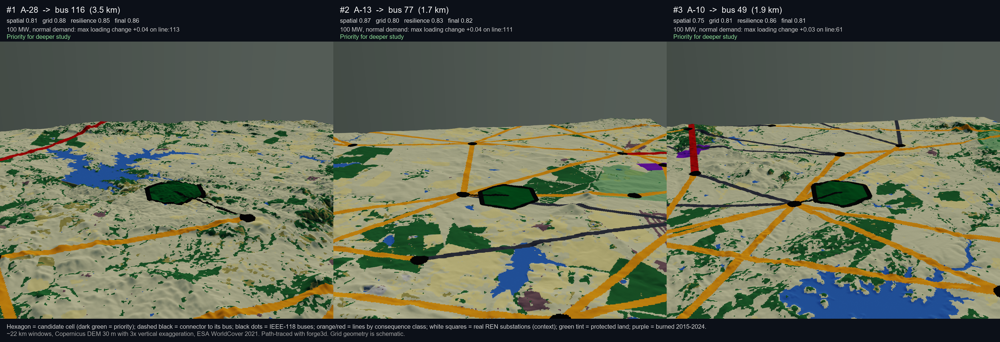
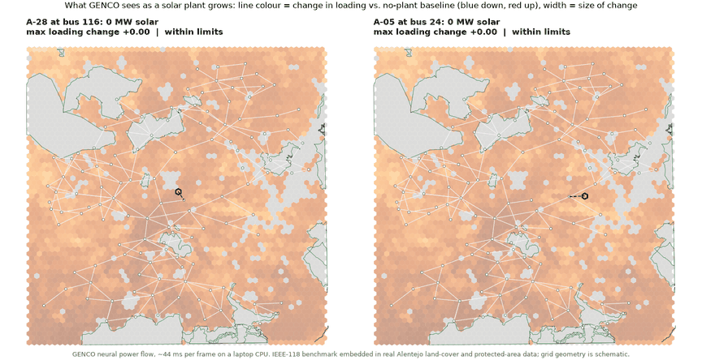

# GeoGridLens

**Grid-aware solar siting: real Alentejo geodata × GENCO neural power flow × AC validation.**
A Polisense AI entry for the GENCO challenge, by Khuzaima Aziz (Co-Founder, Spatial Data Scientist, Polisense AI).

<p>
  <a href="https://YOUR-APP.streamlit.app"></a>
  <a href="https://khuzaimahaziz.github.io/geogridlens/"></a>
  <a href="CASE_STUDY_REPORT.md"></a>
</p>





## The question

Where in a 100 km × 100 km slice of Alentejo, Portugal, could a **100 MW solar plant**
(optionally with a 50 MW battery) connect to the grid with low electrical stress,
on land that is actually buildable, robust to line outages, and away from
wildfire-exposed corridors?

Solar developers pick sites by land; the grid is checked last, for a handful of
finalists, with slow solver studies. GeoGridLens moves the grid check to the front.
GENCO answers a power-flow case in about 44 ms on a laptop CPU, so every plausible
site is screened under many operating conditions and line outages before the
shortlist exists. Real geographic layers decide where a site can exist at all;
GENCO decides which of those sites the grid can take; a conventional AC solver
confirms a documented subset.

## What is in the study

| | |
|---|---|
| Land cells scored from real open data | 3,886 hexagons (Copernicus DEM, ESA WorldCover, Natura 2000 + CDDA, MODIS burned area 2015-2024, PVGIS, OpenStreetMap) |
| Candidate sites | 30, chosen by a documented rule and linked to their nearest bus |
| GENCO scenarios | 2,160 (30 sites × 3 capacities × 4 conditions × intact + 5 outages) + 24 baselines, ~4 min on CPU |
| N-1 outage set | the five most wildfire-exposed lines whose loss keeps the network connected |
| AC validation | 73 pandapower cases on identical inputs; 49 of 49 change comparisons and 35 of 73 absolute comparisons pass strict criteria |
| GENCO vs AC loading changes | slope 0.95, R² 0.98 over 9,086 branch-scenario pairs |
| Model probes | 3 released seeds over all scenarios (worst line agrees in 91 %), outage-only baseline for all 177 connectivity-preserving lines, load sweep 0.5-1.5 with AC at every step |

> **Real versus schematic.** Terrain, land cover, protected areas, burned areas,
> solar yield and settlements are real open data. The electrical network is the
> IEEE-118 benchmark laid out deterministically inside the study box. Bus and line
> positions, candidate-to-bus links and every power-flow number are illustrative
> and must not be read as statements about Portugal's grid or used for any real
> interconnection decision.

## The five maps

| Map | Question | Built from |
|---|---|---|
| 1 Spatial opportunity | Where is a project geographically plausible before any grid analysis? | real layers only |
| 2 Grid stress | What does one plant do to the grid under one condition? | one GENCO scenario minus its baseline |
| 3 Grid robustness | Which sites stay comfortable across capacities and conditions? | 12 GENCO cases per site |
| 4 Wildfire × consequence | Which exposed lines matter most electrically? | real corridor exposure × GENCO redistribution under outages |
| 5 Final suitability | Which sites deserve a real interconnection study? | everything above, under three stated weight profiles |

Headline result: grid scores spread from 0.35 to 0.88 across sites with almost
identical land quality. The site with the best land in the set (A-19) ranks ninth
because its bus is a weak point of the grid, and the top three hold their rank
under all three weight profiles. See the [report](CASE_STUDY_REPORT.md) for the
numbers and its section "What we learned about GENCO" for the diagnostics: error
is local to the perturbation; GENCO's own power-balance residual predicts its
error against AC and marks the edge of its operating envelope; three seeds give
one shortlist.

## Pipeline

```text
real open geodata ──► hex cells, exclusions, spatial opportunity (Map 1)
                      │
IEEE-118 topology ──► geo-embedded buses/branches ──► corridor wildfire exposure
                      │                                      │
                      ├─► 30 candidate sites (documented rule)│
                      │                                      ▼
                      │                       five most exposed lines = N-1 set
                      ▼                                      │
             scenario manifest: 4 + 20 baselines + 2,160 interventions
                      │
             GENCO (released PFDelta Task 1.3 seed-1 checkpoint, native graph)
                      │
             ┌────────┴──────────┐
     scoring (Maps 2-5)   pandapower AC on a documented subset + GENCO diagnostics
             └────────┬──────────┘
                 Streamlit dashboard, figures, report
```

| Step | Script | Output |
|---|---|---|
| Fetch and cache real layers | `scripts/fetch_alentejo_geodata.py` | `data/raw/alentejo/` + `geodata_sources.json` |
| Geo-embed network, hex cells, candidates, N-1 set | `scripts/build_case_study_spatial_layers.py` | `data/spatial/case_study/` |
| Scenario manifest | `scripts/build_case_study_manifest.py` | `outputs/case_study/scenario_manifest.csv` |
| GENCO screen (resumable, stale-safe) | `scripts/run_case_study_genco.py` | `outputs/case_study/genco_results/` |
| Score candidates and branches | `scripts/score_case_study.py` | `outputs/case_study/indicators/` |
| AC validation subset | `scripts/validate_case_study_subset.py` | `outputs/case_study/ac_validation/` |
| GENCO behaviour diagnostics | `scripts/analyze_genco_behaviour.py` | `outputs/case_study/indicators/genco_*.parquet` |
| GENCO extensions: seeds, all-branch outages, sweeps | `scripts/run_genco_extensions.py` | `outputs/case_study/indicators/seed_*.parquet`, `outage_consequence_all_branches*.parquet`, `load_sweep.parquet`, `outputs/case_study/capacity_sweep/` |
| Consolidated Parquet | `scripts/export_case_study_artifacts.py` | `scenario_summary / bus_results / branch_results.parquet` |
| Figures and report | `scripts/write_case_study_report.py` | `outputs/figures/`, `CASE_STUDY_REPORT.md` |
| Presentation visuals | `scripts/make_visuals.py`, `scripts/render_3d_scene.py` | `capacity_sweep.gif`, `same_land_different_grid.png`, `terrain_3d_oblique.png`, `terrain_3d_northeast.png` |

## Run it

Windows PowerShell, Python 3.11, CPU-only PyTorch. Graphkit is installed editable
from a sibling checkout of the `genco-paper-repro-pfdelta` branch
(`../_upstream/gridfm-graphkit`, see `scripts/bootstrap.ps1`).

```powershell
Set-ExecutionPolicy -Scope Process Bypass
.\scripts\bootstrap.ps1                      # venv + Graphkit + requirements-pipeline.txt
.\scripts\download_released_assets.ps1       # PFDelta Task 1.3 case118 (~670 MB) + GENCO seed-1 checkpoint (80 MB)
.\.venv\Scripts\python.exe scripts\verify_environment.py
.\scripts\run_case_study_pipeline.ps1        # whole case study; first run downloads ~20 MB of geodata
.\.venv\Scripts\streamlit.exe run app\case_study_dashboard.py
.\.venv\Scripts\python.exe -m pytest tests   # 8 checks, including solver-bookkeeping regressions
```

The dashboard has eight tabs: overview, the five maps (Map 5 with live weight
sliders and a rank-stability chart), "How GENCO behaved", and validation and
provenance. Maps use a real basemap.

Everything under `data/raw`, `data/spatial`, `models`, `outputs` and `mlruns` is
regenerated and ignored by Git, except the figures, the spatial metadata and the
geodata provenance record. `configs/data_sources.yaml` records the released
dataset and checkpoint identifiers; `data/raw/alentejo/geodata_sources.json`
records every geodata source with access date, resolution and licence.

## How the pieces fit

- **Configuration** (`configs/case_study.yaml`): study box, exclusion rules,
  land-cover suitability table, candidate rule, N-1 selection rule, capacities,
  operating conditions, screening thresholds, weight profiles. Candidates and
  contingencies are derived from the data, never typed in.
- **GENCO path** (`src/genco/`): `native_pfdelta_scenarios.py` edits one feasible
  PFDelta snapshot (loads, fixed-P injection, branch mask) and builds the native
  Graphkit graph; `scenario_inference.py` loads the checkpoint, runs it, reconstructs
  flows and owns the exact PFDelta-to-pandapower branch mapping (parallel circuits
  resolved by impedance). `case_study/genco_screening.py` runs the matrix with
  resume and stale-result detection.
- **Scoring** (`src/case_study/scoring.py`): grid, contingency, resilience and
  final scores, the bivariate branch table, plain-language reasons per candidate,
  rank stability across profiles.
- **Validation and diagnostics** (`src/case_study/ac_validation.py`,
  `genco_behaviour.py`, `src/validation/`): pandapower on the same modified
  snapshots with flows read back in PFDelta order; absolute and change agreement
  reported separately; error by distance from the perturbation; residual as trust flag.
- **Spatial** (`src/case_study/geodata.py`, `spatial_layers.py`, `src/spatial/`):
  fetch and cache real layers, score hex cells, embed the benchmark, select
  candidates and the wildfire-informed N-1 set.

## Hosting the dashboard and the walkthrough

**Dashboard (Streamlit Community Cloud, free).** The repository ships the small
result tables the dashboard needs (`outputs/case_study/**/*.parquet`,
`data/spatial/case_study/*.parquet`, about 40 MB), and `requirements.txt` holds
only the dashboard dependencies, so no GENCO, PyTorch or dataset download is
needed to host it. On https://share.streamlit.io choose "New app", pick this
repository and branch `main`, set the main file to `app/case_study_dashboard.py`,
deploy, then replace `https://YOUR-APP.streamlit.app` in the badge above with
the URL you get. The app reads the consolidated Parquet files when the
per-scenario folders of a full run are absent.

**Walkthrough (GitHub Pages).**

`docs/index.html` is a self-contained page with the figures in `docs/figures/`.
Enable GitHub Pages with source "Deploy from a branch", branch `main`, folder
`/docs`, then replace the placeholder Pages URL in the badge above.

## Layout

- `app/` Streamlit dashboard · `configs/` case study, released GENCO and validation configuration
- `data/raw/` downloads (PFDelta split, Alentejo geodata cache) · `data/spatial/` built layers
- `docs/` walkthrough page and figures · `models/` checkpoint · `outputs/` results, indicators, AC validation, figures
- `scripts/` reproducible entry points · `src/` implementation · `tests/` pytest checks

## Author

Khuzaima Aziz, Co-Founder, Spatial Data Scientist, Polisense AI. Contact: khuzaimaaziz89@gmail.com.

## Credits

GENCO and Graphkit: the GridFM team (IBM Research and partners), paper
arXiv:2608.09921, checkpoint `gridfm/genco-pfdelta`, data `gridfm/pfdelta_task1.3`.
Geodata: Copernicus DEM (ESA/Airbus) and MODIS MCD64A1 (NASA LP DAAC) via Microsoft
Planetary Computer, ESA WorldCover 2021, EEA Natura 2000 and CDDA, JRC PVGIS,
OpenStreetMap contributors. Solver: pandapower. Code in this repository is MIT
licensed (see `LICENSE`); third-party components keep their own licences.
